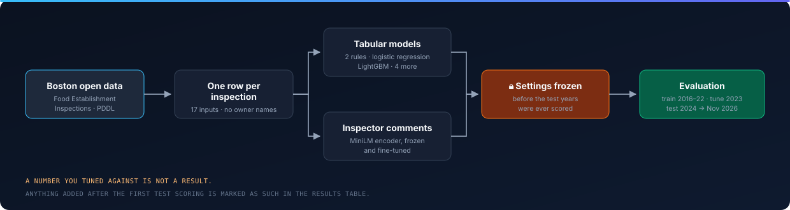

<h1 align="center">Which Boston restaurants should be inspected first?</h1>

  <b>Ranking 6,000 routine inspections a year by the risk of finding a violation.</b> 
  MIT 15.071 — The AI Edge · Project 1 · Fall 2026

  
  
  
  
  

  <b><a href="https://github.com/nh13120/boston-restaurant-inspection-risk">📂 Full analysis, code and notebooks →</a></b>

---

## The problem

Boston's Inspectional Services Department visits each restaurant about twice a year. Across roughly **6,000 routine inspections annually, 59 % fail** — and no published rule decides which visit happens first.

That ordering is free to change. The inspectors, the budget and the yearly total all stay the same; only the sequence moves. So the question is simply: **can the visits most likely to find something be scheduled first?**

## The answer

Yes, by a wide margin.

| Method | Failures found in the first 20 % of visits | 95 % CI |
|---|---|---|
| No ranking *(reference point)* | 59.0 % | 58 – 60 |
| Rule: past failure rate | 80.3 % | 78 – 82 |
| Rule: violations at the last visit | 81.9 % | 80 – 83 |
| Logistic regression | 87.0 % | 85 – 88 |
| **LightGBM on inspection history** ⭐ | **88.1 %** | 86 – 89 |
| LightGBM + fine-tuned inspector comments | 89.1 % | 88 – 90 |

**What that is worth:** about **324 more failed inspections caught each year** within the first 20 % of visits, surfacing **1.1 weeks sooner** — with no extra inspectors and no extra budget. It matches the best hand-written rule's count using **10 % fewer visits**.

## How it was built

**The settings were frozen before the test years were ever scored.** Train on 2016–2022, tune on 2023, and only then look at 2024 through November 2026. Anything added after that first scoring is marked as such in the results — because a number you tuned against is not a result.

## Two findings worth keeping

**Fairness is a design choice, and it was measured.** Dorchester and Roxbury fail inspections at the same rate. Under the full model they received **46 %** and **19 %** of early visits. Dropping location features evened that to **35 %** and **24 %** — and cost nothing: accuracy stayed within noise (+0.6 points). That is the version recommended for deployment.

**Complexity has to earn its place.** A fine-tuned transformer on inspector comments beat the final model by **one point** (0.3 – 1.8). One point, in exchange for a neural network to serve, monitor and retrain. The simpler model shipped.

## Honest limits

- ISD's real ordering is **estimated** from visit dates, not published.
- The test **reorders past visits**. A live pilot is the only way to confirm the gain.
- Performance **decays**: the hit rate fell from 90.1 % (2024) to 84.9 % (2026). Refit yearly.

---

  <b>Nicolas Hong · Louis Neubauer · Robin Cen · Jose Plaza Carreras</b> 
  MIT 15.071, Fall 2026 · Data: <a href="https://data.boston.gov/dataset/food-establishment-inspections">Boston Food Establishment Inspections</a> (PDDL)

  This repository is the course placeholder. The code, notebooks, data pipeline and results all live in the 
  <b><a href="https://github.com/nh13120/boston-restaurant-inspection-risk">team repository →</a></b>

